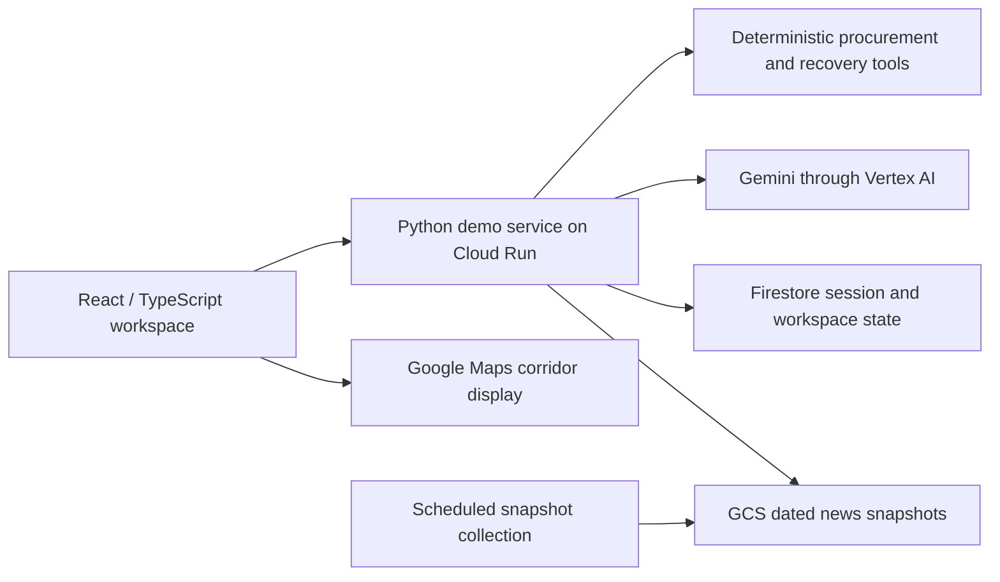

# ZOORQ

**A procurement decision workspace for manufacturers.** ZOORQ connects company inventory, supplier quotes, shipment evidence, public news and route context so a buyer can see what a disruption means and prepare a reviewed response.

**[Try the hosted demo](https://zoorq-963802031195.asia-south1.run.app/demo)** · [Explore dated market predictions](https://zoorq-963802031195.asia-south1.run.app/demo?view=predictions) · [Open issues](https://github.com/deevyanshoo/Closed_Source_Builders_Cup/issues)

Start with **Solara Cables**, then switch among ten fictional company workspaces covering 52 synthetic material scenarios. The sample company, transactions, stock and supplier records are illustrative; public news and market reference data carry their own source dates.

> **Judges: [Start with the 2-minute ZOORQ handbook](docs/JUDGES_GUIDE.md)** — explore live news, Global Watch and the multilingual voice operator.

## The decision loop

1. **See the exposure.** Inspect material stock cover, orders, supplier quotes, shipments and dated news in the current company context.
2. **Compare options.** Review quote comparisons, inventory-aware purchase plans, delay recovery and supported route corridors. A planned order date alone does not prove that a stock gap is covered before delivery.
3. **Ask the Operator.** Type a question or use native Gemini Live voice. Company-owned read tools provide inventory and sourcing facts; new external research needs explicit query consent. Action proposals require review.
4. **Prepare the next step.** Save an RFQ draft and inspect its exact contents. RFQs remain **UNSENT**; the demo does not contact suppliers or place orders.

The workspace also shows covered emissions estimates and dated commodity/FX prediction references. Missing emission factors stay missing; forecasts include uncertainty and have **no validated business decision edge**. They are reference context, not live price feeds or buy/wait advice. Google Maps displays supported route corridors, which can be schematic; it is not live shipment tracking.

## Built on Google Cloud



The hosted judge experience is built from [`apps/web`](apps/web) and [`procurement-engine`](procurement-engine). The repository also preserves the original Python procurement prototype and a Go gateway under [`services/gateway`](services/gateway); those components are not all part of the hosted release. Cloud Build packages the reviewed web and Python service for Cloud Run. Firestore persists anonymous workspaces; GCS stores bounded public-news snapshots. The Operator uses Gemini for language and consented research while owned tools perform numeric and stateful work.

## Try it in five minutes

1. Open the [hosted demo](https://zoorq-963802031195.asia-south1.run.app/demo) and select Solara Cables.
2. Ask the Operator what its copper stock cover means for the next receipt. Review the dated inventory and supplier inputs.
3. Compare the purchase plan with the delivery timing. The illustrative October 14 snapshot has about six days of copper cover and a shortest listed lead of about ten days; the reviewed recovery flow exposes the intervening gap.
4. Review a bridge RFQ draft. It stays unsent until an actual external procurement workflow exists.
5. Switch company to see how context, materials and answers change; open [market predictions](https://zoorq-963802031195.asia-south1.run.app/demo?view=predictions) for dated reference ranges.

The demo is a decision-support prototype. News headlines indicate possible exposure, not confirmed shipment delays. Route lines do not establish carrier events or supplier availability. Carbon figures are estimates where cited factors exist. The typed and controlled-audio paths have automated QA; physical microphone and human listening acceptance remain separate checks. A [Portuguese forecast voice grounding issue](https://github.com/deevyanshoo/Closed_Source_Builders_Cup/issues/138) remains open.

## Develop locally

Requires Python 3.10+ and Node.js compatible with the Vite project. The hosted service needs Google Cloud configuration; the legacy prototype has a keyless local path.

```bash
# Web checks
cd apps/web
npm ci
npm run typecheck
npm test
npm run build

# Python checks (from the repository root)
cd ../../procurement-engine
python3 -m venv .venv
.venv/bin/python -m pip install -r requirements.txt
.venv/bin/python -m pip install -e .
.venv/bin/python -m pytest
```

For the original standalone prototype, see [`procurement-engine/README.md`](procurement-engine/README.md). For the hosted package and runtime boundaries, see [`deploy/judge-demo/README.md`](deploy/judge-demo/README.md). Keep provider credentials in runtime configuration; the repo's synthetic fixtures do not require real buyer or supplier data.

## Project status and roadmap

The hosted demo supports the decision loop above. Work in progress includes export-market ranking, broader carbon-source coverage, operator answers for carbon, dispatch polish and forecast validation. Longer-range proposals cover a buyer/seller marketplace, exporter workspace, production-aware maintenance, live shipment tracking, cross-border dispatch, bulk-order intelligence and ERP integrations. Track these as issues; they are not shipped capabilities.

ZOORQ builds on Taher Afsar's procurement prototype (tag `baseline-2026-10-06`). See [`CONTRIBUTING.md`](CONTRIBUTING.md) for contribution workflow.
