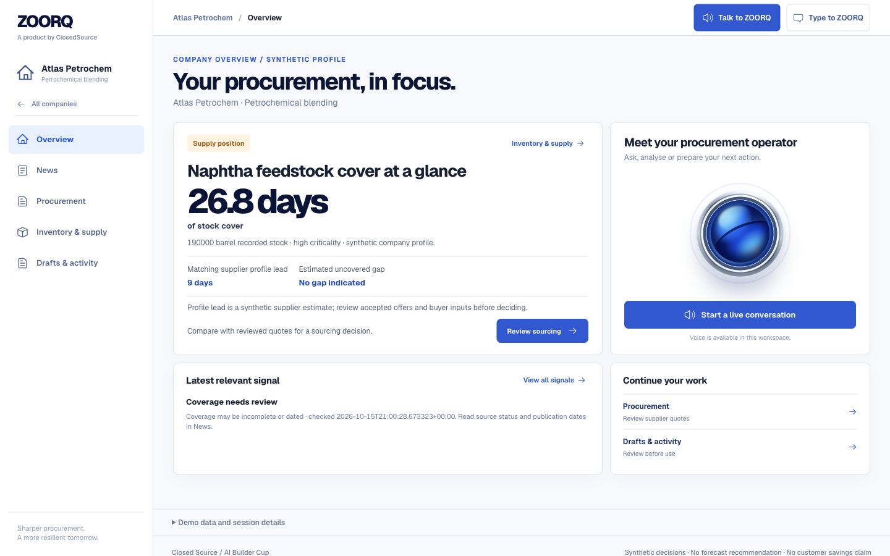
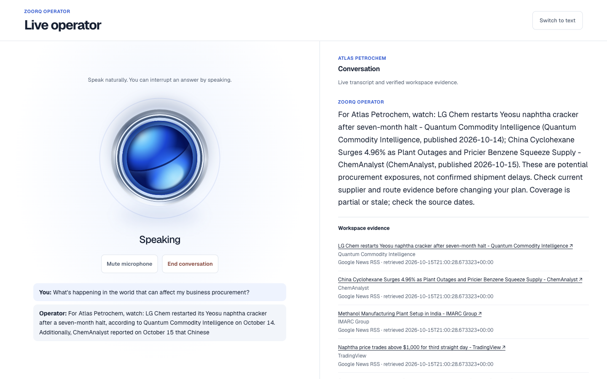

# ZOORQ white, ink and cobalt release — 16 October 2026

## Experience and scope

The implemented workspace uses a white canvas, ink typography and cobalt actions. It adds a searchable ten-company hub, persistent desktop rail and mobile navigation, company Overview, News, Procurement, Inventory & supply, and Drafts & activity routes. Company data and saved work remain in the existing controller. The news inbox, quote review and comparison, recovery, unsent RFQ drafts, and operator share the new visual system. A state-driven spatial lens makes Talk to ZOORQ prominent while using the existing single Live Voice connection, current research consent, visible captions and source details, and Mute, End and return-to-text controls. Reduced motion and mobile touch controls were checked. Small backend changes tightened news relevance and safe diagnostic logging; no database/schema migration was introduced.

## Release state

- Final source: `b45e82f186df2be8b7254b6cd5ad4880b2014cfa` (runtime source; later documentation-only commits do not require a new image).
- Cloud Build: `1fbdc03f-a69c-4968-b498-35b426d6724b`, **SUCCESS**. Built immutable image: `sha256:0d242410f0acdae9b08064cd5d729d415ed516c9535bbc37d3b235d12d22c37e`.
- Final serving Cloud Run revision: `closed-source-quote-demo-00052-5k4`, **100% traffic**, running the built image above. Both existing service URLs returned `ready: true`, Firestore ready and revision r52. Runtime identity, environment, resources, concurrency and timeout matched the preceding revision; max scale remains 1.
- Final hosted news acceptance: r51 ten-company audit **passed with zero findings**. The subsequent r52 delta only increases supply-card qualifier size/contrast. On r52, all ten companies × five destinations × desktop/mobile passed again (100 route observations); final mobile text analytics returned StoneBridge cement-clinker cover of 26.04 days, consistent with its rounded 26-day overview. On r51, the final news voice question returned current company evidence, one socket/stream, 1,056,003 output audio bytes and complete End disposal/focus return. The voice/news components were unchanged by r52. The original regional Meridian Pharma browser cookie was restored and visibly verified; QA media/display overrides were removed, the task-owned preview stopped and existing primary user tabs left untouched.
- Existing service/project: `closed-source-quote-demo`, `closed-source-builder-261007`, `asia-south1`. The checked pre-deploy trial was unupgraded, with INR 27,932.94 credit and 64 days remaining at `2026-10-15T20:41:24Z`. A later authenticated console check showed INR 27,932.66, 64 days and still unupgraded. Existing limits were 1 CPU, 1 GiB, max 1 instance, concurrency 8 and 240-second timeout. No new IAM grant, billing upgrade, service or resource-cap increase was made for this work.
- Rollback target: retained known-good `closed-source-quote-demo-00050-z2x`; image `sha256:2a430e2ea1a766371153ad2a2131330503d1d542be6606071200245f965a7413` remains retained. Roll back traffic to that known-good revision if a later regression is confirmed; no migration rollback is needed.

## Verification already recorded

- Final local gate reported by integration: **403 web tests passed, 6 existing skips**, plus session-race check, TypeScript check and production build; **767 backend tests passed**. These are local checks, not final-image hosted acceptance. No CI is configured for this branch.
- Browser route matrix: ten companies × five routes × two sizes in local preview and the then-current hosted service = **200 route observations**. Recorded company identity and navigation presence, Talk visibility and no horizontal overflow at 390 px mobile and 1440 px desktop. A separate final r52 matrix adds 100 hosted observations, bringing the recorded total to 300 route observations.
- Hosted r49 (`closed-source-quote-demo-00049-v2c`): **20/20 typed model turns** across ten companies and **10/10 controlled-speech inventory voices**. Typed model coverage was inventory analytics and form fill; quote, recovery and RFQ checks used rules-mode REST. Controlled speech traversed actual WebSocket/audio output, but no physical microphone hardware was tested.
- Hosted r50 (`closed-source-quote-demo-00050-z2x`): **10/10 direct quote → plan → recovery → unsent RFQ/replay/download and saved-draft workflows** passed in rules mode. Ten-company news/Global Watch audit passed with zero structural findings. Three document extractions used the real Gemini provider (`gemini-3.5-flash-lite`) and retained document evidence. Browser receipts record one controlled voice connection with news/audio, 44 px controls, reduced-motion behavior, End closing the dock and stopping its track. Earlier browser receipts record visible industry-specific spoken research consent, spoken confirmation on the same connection, completed result and sources, plus an unsent email draft and one reviewed simulation; no external delivery occurred.

## Evidence and limits

Evidence lives outside the repository in the task's `output/evidence/` directory: `zoorq-cobalt-browser-routes-20261016.json`, `zoorq-cobalt-agent-actions-final-20261016.json`, `zoorq-cobalt-voice-final-20261016.json`, `zoorq-cobalt-workflow-delivery-20261016.json`, `zoorq-cobalt-news-delivery-20261016.json`, `zoorq-cobalt-gemini-extraction-20261016.json`, `zoorq-cobalt-browser-voice-r48-20261016.json`, `zoorq-cobalt-browser-actions-r49-20261016.json`, `zoorq-cobalt-browser-voice-r50-20261016.json`, and final r51 news receipt `zoorq-cobalt-news-r51-20261016.json`. Trial receipt: `.superpowers/sdd/2026-10-16-zoorq-cobalt-experience/trial-gate.json`. Final receipts: `zoorq-cobalt-release-r52-20261016.json`, `zoorq-cobalt-browser-routes-r52-20261016.json`, `zoorq-cobalt-browser-voice-r51-20261016.json` and `zoorq-cobalt-text-r52-20261016.json`. Bounded public release/route/Gemini receipts and six product screenshots are checked in under [docs/ux/2026-10-16](ux/2026-10-16). Overview and chat screenshots show r52; news and voice show r51, whose relevant component code is unchanged in r52.

An early hosted Harvest Foods typed form returned `unavailable`; the exact local form and real Vertex path worked, but the hosted provider/role failure was not isolated. The action failed closed. Later r49 typed coverage passed all 20 turns; category/hash-only diagnostic logging was added without raw private payloads. The old `smoke.py` ephemeral-session run returned `invalid_session` on r50; that contract is obsolete and is not evidence that the direct workflow or real Gemini extraction failed. Structural news acceptance does not certify every headline's relevance or factual claim. No real supplier email or order was sent.

Two native Antigravity workers saved their scoped patches before exiting with ENOSPC; follow-on chat agents completed and reviewed the integration. Their original exits are not counted as successful test runs. This record separates the built image from any later serving revision or final hosted result.

## Final visual review

The first desktop news row starts at 314.09 px in a 1200×664 viewport. The final supply-card labels and qualifiers render at 12 px in `#526174` on white (approximately 6.32:1 contrast), verified on desktop and mobile after the independent reviewer flagged the earlier pale small text. The CSS-only polish passed typecheck and production build; no additional behavior test was added for font declarations.

[Deployed product](https://closed-source-quote-demo-ryoeyuqvta-el.a.run.app/demo) · [Focused PR118](https://github.com/deevyanshoo/Closed_Source_Builders_Cup/pull/118)

