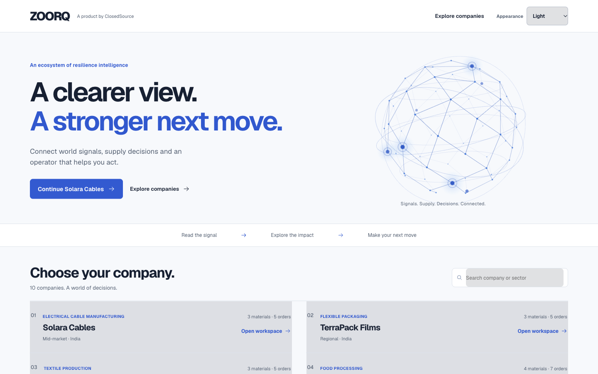
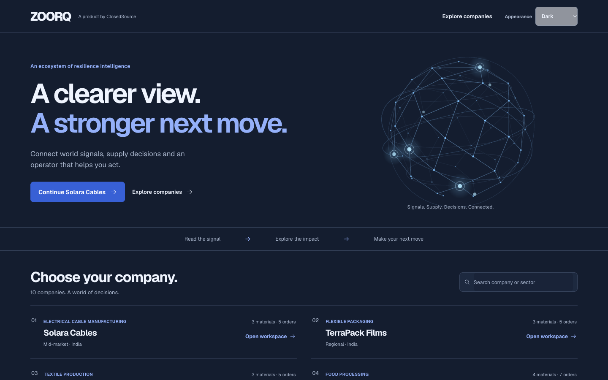
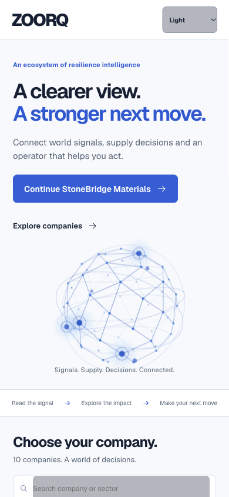
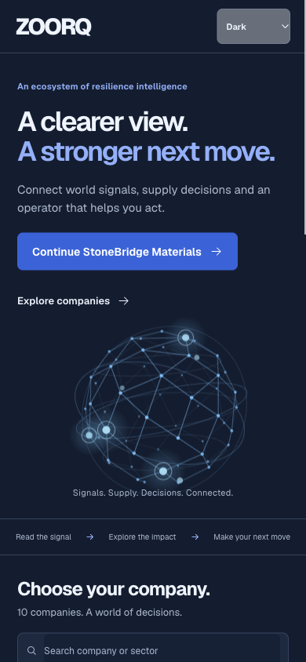
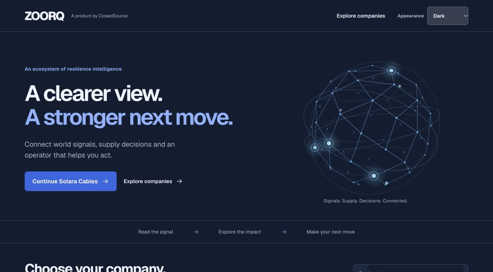

# ZOORQ entrance and theme release — 16 October 2026

## Delivered experience

The `/demo` entrance now presents ZOORQ's company ecosystem with a dimensional network canvas, a clear path into the ten-company index, and a persistent Appearance selector. Light keeps the prior white, ink and cobalt palette; Dark uses a contrast-checked navy palette; System follows the operating-system setting. The validated preference is saved locally and applied by a same-origin script before the workspace loads, without relaxing the existing Content Security Policy. The selector changes presentation only: company/session state, quote and RFQ review, research consent, and voice action boundaries are unchanged.

The voice lens uses the public thinking-orbs/engine API from installed version 0.3.2. The package supplies its established particle geometry; the canvas renders at the measured display size with pixel density capped at 2x, instead of enlarging a 64 px bitmap. Animation is limited to 30 fps and pauses when hidden, offscreen or reduced motion is requested. The existing input processor and an optional visual analyser on the existing output context drive audio response at 10 Hz. No additional microphone capture, audio context or voice socket is created. The entrance network rotates and responds to pointer position during normal motion. Under reduced motion, repeat canvas captures had a stable hash.

## Deployed identity and operating boundary

- Runtime source: `00badd13f5068d5d733c80e1364251dc6d982e5f`.
- Cloud Build `caced313-2d05-46a3-9e45-53525c6d39bc`: **SUCCESS**; immutable image `sha256:cde6a98b7fd191767c1023f18c171cb1fcbadd7452f5d846540c3a37ea86ef67`.
- Cloud Run `closed-source-quote-demo-00055-59s`: **100% traffic**. Both existing service URLs returned `ready: true`, Firestore ready, the exact revision and HTTP 200 for `/assets/theme-init.js`. The service identity, environment, resources, concurrency, timeout and maximum scale of **one** match r52 exactly. No backend code, database migration, new service, IAM grant or billing upgrade was part of this change.
- The authenticated console showed an **unupgraded Free Trial** with INR 27,887.31 credit and 64 days remaining before the final deployment. This is a point-in-time balance, not a claim of zero usage.
- Rollback target: r52 image `sha256:0d242410f0acdae9b08064cd5d729d415ed516c9535bbc37d3b235d12d22c37e`. Route the existing service back to its retained r52 revision if a release regression is confirmed; no migration rollback is required.

## Verification and evidence

The r54 local gate passed **415 web tests**, with six existing skips, the session-race check, TypeScript checking and a production build. The final r55 CSS-only reduced-motion adjustment also passed a production build and hosted computed-style verification. Backend code did not change, so the full backend suite was not rerun. The local matrix and the r53 hosted browser matrix each recorded **200 route observations**: ten companies × five workspace destinations × two themes × desktop/mobile. Every recorded route retained company identity, navigation, Appearance and Talk controls, with no horizontal overflow at 390 or 1440 px. System mode followed an emulated dark-to-light operating-system change; an explicit saved Dark choice applied before the workspace appeared after reload. One StoneBridge fresh-snapshot bridge heading took approximately three seconds to settle, after which its five route checks resumed; this was not a product failure.

The sanitized receipts are in the task workspace's `output/evidence/entrance-final/`: `deployment-final.json`, `local-theme-routes.json`, and `hosted-theme-routes.json`. Four entrance captures are available there and are linked below at their repository review paths. The four desktop/mobile matrix landing images show r53; the additional light/dark release captures show r55; the sharp voice images show r54. The subsequent change only suppresses audio-driven CSS scaling/opacity under reduced motion. A native Antigravity Terminal 6 GPT-6 Sol visual worker exited **0** after its two-file scoped task; chat workers handled theme and orb work in parallel, and the coordinator integrated voice. An independent voice integration review approved with no P1/P2 findings. No model cost estimate is claimed.

Hosted voice acceptance on r53 showed the news question using recent company sources; on r54 the sharpened renderer answered the inventory question with the correct company stock position. Measured input/output peaks were 0.92 and 1.00 on r54, and all connecting/listening/thinking/speaking states appeared. Mobile canvas pixels matched its 180 px display at DPR 1; unit checks also cover the 2x cap. Changing Light/Dark from another tab left the same one voice socket active. End closed the one socket, stopped the one capture track, removed the dialog and returned focus to Talk. The r54 voice run received 880,803 output audio bytes. These are actual media/WebSocket exchanges driven by controlled speech.

One r53 typed naphtha-cover request failed closed; the safe log category was provider. A later inventory-summary request returned the correct 190000 barrel stock, 7100 barrel/day consumption and approximately 26.76 days of cover. No action was taken on the failed request; this release does not claim that provider outages have been removed.

On hosted r55, reduced motion produced a static orb with `transform: none` and opacity 1, including when an audio-scale value was applied. The original regional Meridian Pharma session and original light preference were restored, the temporary QA tabs were closed, and device/media overrides were cleared. A new primary-host landing tab was left open in Light mode; existing primary tabs were not reloaded. Controlled or browser audio evidence does not establish physical microphone hardware quality or a human acceptance test. No real supplier message or order was sent.

 · 

 · 

[Live ZOORQ](https://closed-source-quote-demo-ryoeyuqvta-el.a.run.app/demo) · [PR118](https://github.com/deevyanshoo/Closed_Source_Builders_Cup/pull/118)
